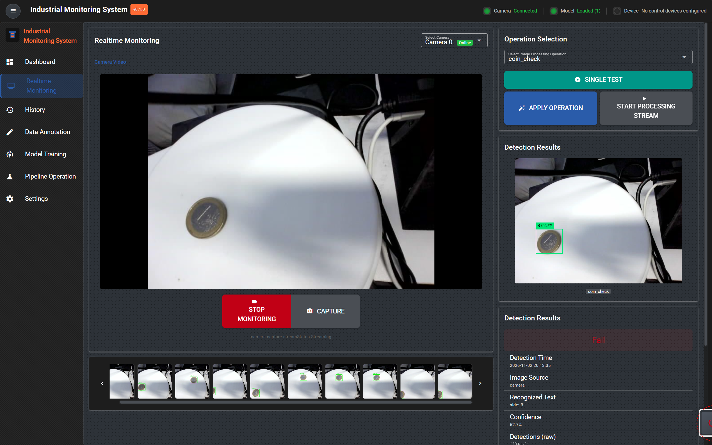
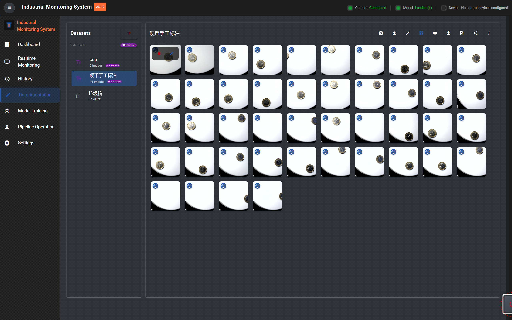
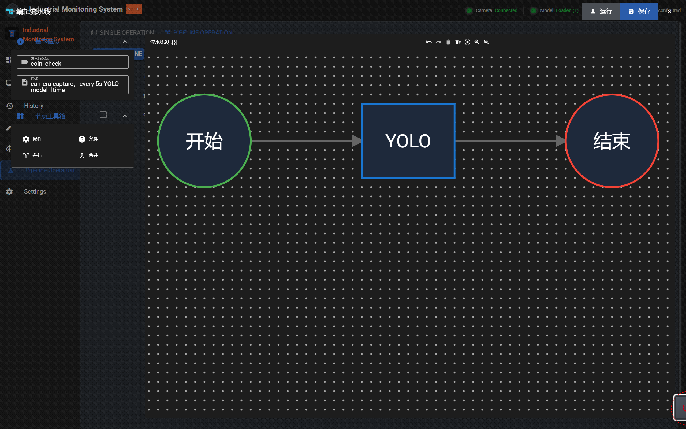
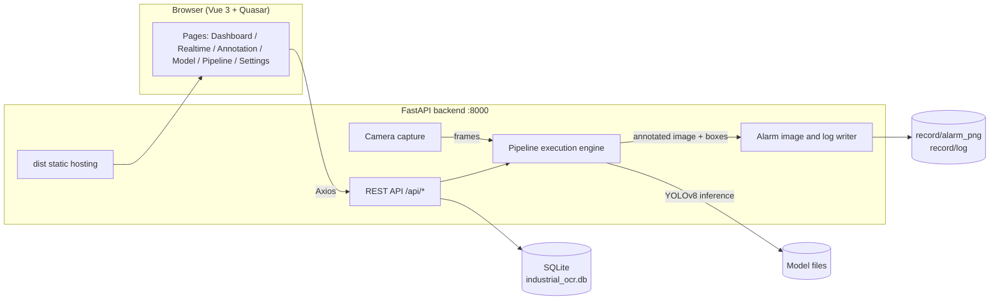

# Industrial Monitoring System

**English** · [简体中文](README.zh-CN.md)

> An industrial computer-vision platform covering the full loop — image capture → data annotation → model training → single-operation / pipeline orchestration → realtime detection with alarm archiving — all inside one web UI, with no code rewrite per new scenario.

[](https://vuejs.org/)
[](https://quasar.dev/)
[](https://fastapi.tiangolo.com/)
[](https://docs.ultralytics.com/)
[](LICENSE)

---

## Screenshots

### Realtime Monitoring

Live camera view, operation selection, single test with result playback, and an alarm thumbnail strip (FIFO, up to 20 images, click to view the full frame).



### Data Annotation

Dataset management on the left, image grid on the right; supports import / capture / rename / export, with annotated images badged.



### Pipeline Operation

A LogicFlow-based visual canvas: drag operation nodes in and wire them into a `Start → Operation → End` execution chain, then run or save from the toolbar.



---

## Modules

| Menu | Route | Capabilities |
| --- | --- | --- |
| Dashboard | `/dashboard` | System status (CPU / memory / disk, refreshed every 5s) and detection statistics |
| Realtime Monitoring | `/realtime` | Live camera preview, operation/pipeline selection, single test, streaming detection, result details, alarm thumbnail strip |
| History | `/history` | Query and review historical detection records |
| Data Annotation | `/annotation` | Dataset and sample management, browser-based annotation, export of training data |
| Model Training | `/model` | Model list, training runs, per-model testing (`/model/test/:id`) |
| Pipeline Operation | `/cv-operations` | Single-operation management and visual pipeline orchestration |
| Settings | `/settings` | Language switching, device and system configuration |

> All UI strings go through i18n. Six locales are bundled: `zh-CN`, `en`, `fr`, `es`, `ar`, `ary`.

---

## Tech Stack

| Layer | Choice |
| --- | --- |
| Frontend | Vue 3 + Vite 4 + Quasar 2 + Pinia + vue-router (hash mode) + vue-i18n |
| Visualization | ECharts / Chart.js (dashboards), LogicFlow (pipeline canvas), Monaco / xterm (scripts and logs) |
| Image interaction | Konva / Fabric / OpenSeadragon + Annotorious, opencv.js (in-browser preview and annotation) |
| Backend | FastAPI + Uvicorn, SQLAlchemy + SQLite, Pillow / NumPy / OpenCV |
| Algorithms | Ultralytics YOLOv8 (detection), PyTorch / TorchVision, scikit-learn |
| Transport & storage | Axios (REST), socket.io-client, psutil (system metrics) |
| Deployment | The backend serves the frontend `dist/` itself — single port 8000, no extra Nginx |

---

## Architecture



---

## Directory Layout

```text
industrial-computer-vision-platform/
├── src/
│   ├── App.vue / main.js
│   ├── router/               # Routes (hash mode, 7 main pages + 404)
│   ├── views/                # Pages: Dashboard / Realtime / History / Annotation / Model / CVOperation / Settings
│   ├── components/           # Feature components: annotation / capture / cv / layout / model / common
│   ├── services/             # Frontend API layer (axios)
│   ├── stores/               # Pinia state
│   ├── i18n/locales/         # 6 locale bundles
│   ├── styles/ utils/
│   └── backend/
│       ├── main.py           # Entry point: routes, mounts dist / uploads / record, warm-up
│       ├── config/settings.py# Central config (port, paths, thresholds, alarm dirs)
│       ├── routers/          # REST routers: annotation / camera / cv_operation / dashboard /
│       │                     #               detection / model / pipeline / settings
│       ├── services/         # Business logic: capture, detection, pipeline, models, annotation, metrics
│       ├── models/           # SQLAlchemy models (datasets/images/annotations/pipelines/
│       │                     #   cv_operations/models/settings/devices/detections/alerts)
│       └── common/
├── ui_png/                   # Screenshots used in this document
├── data/ models/ weights/ runs/   # Datasets, model weights, training artefacts
├── record/                   # Runtime output: alarm_png/ (alarm images, FIFO 20), log/ (daily logs)
├── uploads/                  # Uploaded originals and assets
├── dist/                     # Frontend build output (served by the backend)
├── 启动系统.bat / start.bat / start.ps1 / start.sh
├── requirements.txt / package.json / vite.config.ts
└── industrial_ocr.db         # SQLite database (created on first start)
```

---

## Quick Start

### Requirements

- Python 3.10+ (3.12 recommended)
- Node.js 16+ (only needed to build the frontend)
- Windows or Linux; a camera is optional — annotation and model features work without one

### Option 1 — One-click launch (Windows, recommended)

Double-click `启动系统.bat`. The script:

1. checks that `.venv` exists;
2. starts `uvicorn src.backend.main:app` with the project root as the working directory;
3. opens <http://127.0.0.1:8000/> automatically after 4 seconds.

Close the server window to stop the system.

### Option 2 — Manual start

```bash
# 1. Install backend dependencies (first time only)
python -m venv .venv
.venv\Scripts\activate          # Linux/macOS: source .venv/bin/activate
pip install -r requirements.txt

# 2. Build the frontend (first time, and after every frontend change)
npm install
npm run build                    # outputs to dist/, served by the backend

# 3. Start the backend (must run from the project root)
python -m uvicorn src.backend.main:app --host 0.0.0.0 --port 8000
```

- App: <http://127.0.0.1:8000/>
- API docs: <http://127.0.0.1:8000/docs>

### Frontend development mode (hot reload)

```bash
# Terminal 1 — backend
python -m uvicorn src.backend.main:app --reload --port 8000

# Terminal 2 — frontend
npm run dev
```

Use the Vite dev-server URL it prints. Before publishing, run `npm run build` — otherwise the backend keeps serving the stale `dist/`.

> `start.bat` is the older script: it creates `.venv`, installs dependencies and starts with `--reload`, which is handy for first-time setup.

---

## End-to-end Workflow

1. **Create a dataset** — open `Data Annotation`, create a dataset (detection or OCR type), import images or capture on the spot.
2. **Annotate** — draw detection boxes or mark text regions, then export the set for training.
3. **Train a model** — open `Model Training`, start a run on the dataset, then test it on single images from the model detail page.
4. **Configure an operation** — in `Pipeline Operation` → `SINGLE OPERATION`, set up a single step (e.g. YOLO detection) with model, confidence and IoU thresholds.
5. **Build a pipeline** — switch to `PIPELINE OPERATION`, wire operation nodes into a `Start → YOLO → End` chain and save it.
6. **Run it live** — open `Realtime Monitoring`, pick the operation and hit `SINGLE TEST` to verify once; use `APPLY OPERATION` then `START PROCESSING STREAM` for continuous detection with results and alarm images streamed back.

---

## How It Works

**Pipeline execution engine**
Nodes fall into four kinds — operation / condition / parallel / merge — and run in topological order, passing images and intermediate data through a `results` dict. A YOLO node falls back to capturing a fresh camera frame when no upstream image exists, so a chain can be debugged in isolation.

**Detection result playback**
Each detection returns an annotated image (boxes plus confidence) together with details: class, recognized text, confidence and raw detections. The backend redraws the annotated frame from bbox coordinates on the original image, so it never depends on an upstream image that may have been lost in transit.

**Alarm archiving (FIFO)**
Annotated alarm frames are written to `record/alarm_png/`; once more than 20 exist the oldest is deleted. Logs are written per day to `record/log/detection_YYYYMMDD.log`. The thumbnail strip at the bottom of the Realtime page reads that directory, and clicking any thumbnail opens the full-resolution image.

**Centralized configuration**
Port, CORS, database, upload directory, default detection thresholds and alarm directories all live in `src/backend/config/settings.py`; business code imports them instead of scattering constants.

**System metrics**
`psutil` sampling (`cpu_percent(interval=0.5)`) avoids the first-call-zero pitfall; disk usage is measured on `C:\` under Windows, and the Dashboard refreshes every 5 seconds.

---

## API Overview

| Prefix | Purpose |
| --- | --- |
| `/api/dashboard` | System status and statistics |
| `/api/cameras` | Camera discovery, frame capture, streaming detection |
| `/api/annotation` | Dataset, image and annotation CRUD, import/export |
| `/api/models` | Model list, training, single-image testing |
| `/api/pipelines` | Pipeline definition and execution |
| `/api/cv/operations` | Single-operation (CV Operation) configuration |
| `/api/detections` | Detection records and alarm image listing |
| `/api/settings` | System settings and language |

Full interactive documentation is available at `/docs` once the server is running.

---

## Configuration

Key entries in `src/backend/config/settings.py`:

| Key | Default | Meaning |
| --- | --- | --- |
| `APP_HOST` / `APP_PORT` | `0.0.0.0` / `8000` | Listen address and port |
| `DATABASE_URL` | `sqlite:///./industrial_ocr.db` | Database (relative to project root) |
| `UPLOADS_DIR` | `uploads` | Uploaded assets |
| `DIST_DIR` | `dist` | Frontend build output |
| `PIPELINE_INTERVAL` | `5` | Streaming detection interval (seconds) |
| `PIPELINE_MODEL_ID` / `PIPELINE_CONF_THRES` / `PIPELINE_IOU_THRES` | `1` / `0.5` / `0.7` | Default model and inference thresholds |
| `RECORD_DIR` | `record` | Root of runtime artefacts |
| `ALARM_IMAGES_DIR` / `LOGS_DIR` | `record/alarm_png` / `record/log` | Alarm images and logs |

---

## Notes

- **Always start from the project root**: `dist`, `industrial_ocr.db`, `uploads` and `record` are all relative paths — starting elsewhere means no frontend and no database.
- **Rebuild after frontend changes**: the backend serves `dist/`; `npm run dev` only affects the dev server.
- **First model load is slow**: warm-up happens at process start, so the first frame after a cold start takes noticeably longer than later ones.
- **Runtime artefacts are not committed**: `record/`, `dist/`, `uploads/`, `.venv/`, `node_modules/`, `*.db` and `*.log` are ignored via `.gitignore`.
- **Screenshots**: all images come from `ui_png/`; update the paths here if you replace them.

---

## License

[AGPL-3.0](LICENSE)
