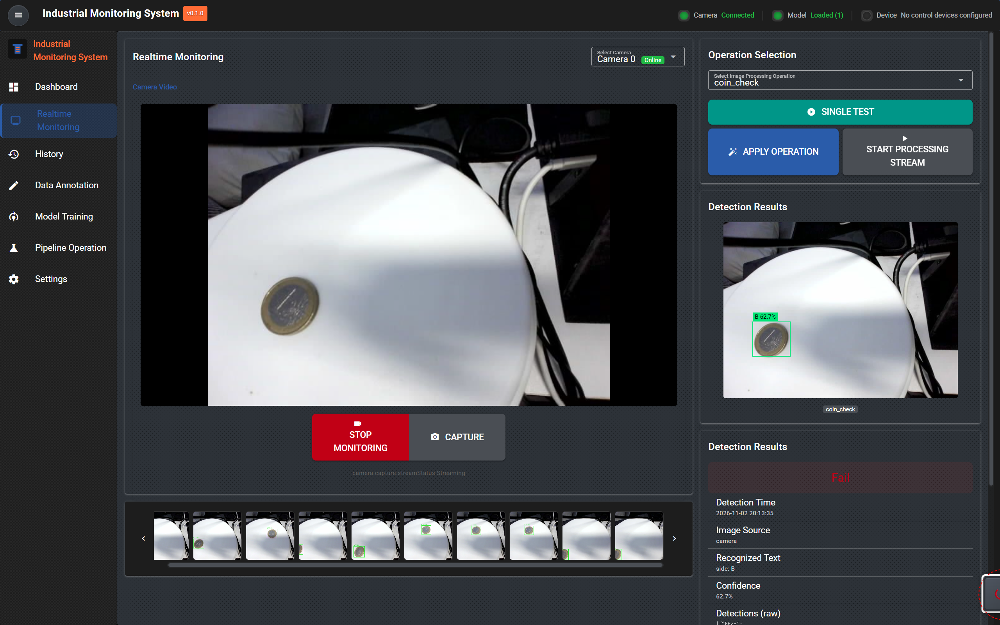
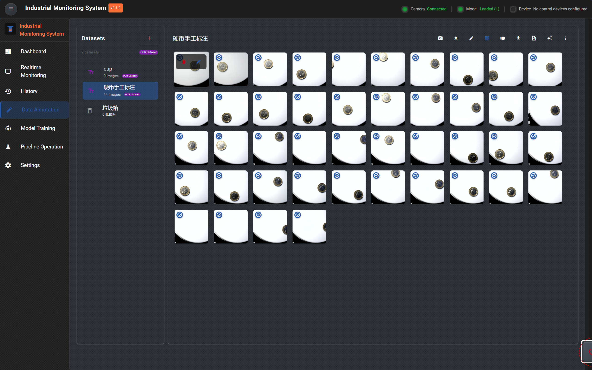
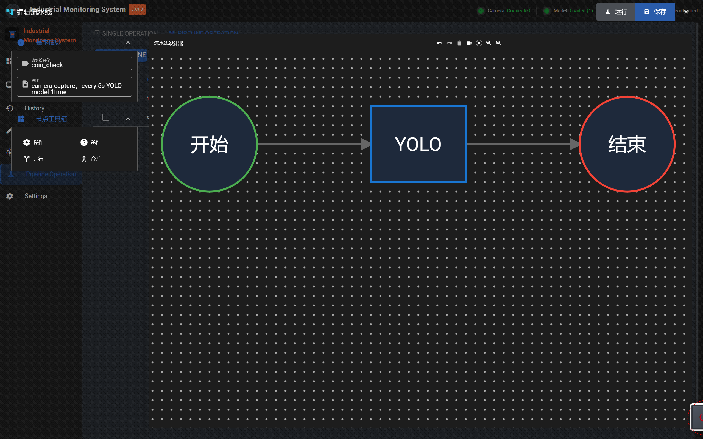
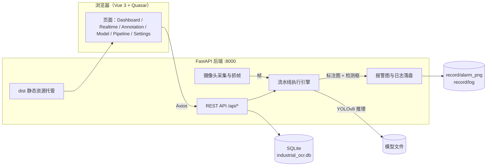

# Industrial Monitoring System

[English](README.md) · **简体中文**

> 面向工业现场的视觉检测平台：图像采集 → 数据标注 → 模型训练 → 单步算子 / 流水线编排 → 实时检测与报警留档，全流程在一个 Web 界面里完成，无需为每个新场景重写代码。

[](https://vuejs.org/)
[](https://quasar.dev/)
[](https://fastapi.tiangolo.com/)
[](https://docs.ultralytics.com/)
[](LICENSE)

---

## 界面预览

### 实时监控（Realtime Monitoring）

摄像头实时画面 + 操作选择 + 单次测试 / 结果回传 + 报警缩略图条（FIFO，最多保留 20 张，点击可查看原图）。



### 数据标注（Data Annotation）

左侧数据集管理，右侧图片网格；支持导入 / 截图 / 重命名 / 导出，已标注图片带角标。



### 流水线编排（Pipeline Operation）

基于 LogicFlow 的可视化画布：拖入算子节点，连线成「开始 → 算子 → 结束」的执行链路，右侧可运行 / 保存。



---

## 功能模块

| 导航菜单 | 路由 | 主要能力 |
| --- | --- | --- |
| Dashboard | `/dashboard` | 系统运行状态（CPU / 内存 / 磁盘，5 秒刷新）、检测统计看板 |
| Realtime Monitoring | `/realtime` | 摄像头实时预览、选择算子/流水线、单次测试、流式检测、检测明细、报警图缩略条 |
| History | `/history` | 历史检测记录查询与回溯 |
| Data Annotation | `/annotation` | 数据集与样本管理、在线标注、导出训练数据 |
| Model Training | `/model` | 模型列表、训练任务、模型测试（`/model/test/:id`） |
| Pipeline Operation | `/cv-operations` | 单步算子管理与流水线可视化编排 |
| Settings | `/settings` | 语言切换、设备与系统参数配置 |

> 界面文案统一走 i18n，内置 6 种语言：`zh-CN`、`en`、`fr`、`es`、`ar`、`ary`。

---

## 技术栈

| 层次 | 选型 |
| --- | --- |
| 前端框架 | Vue 3 + Vite 4 + Quasar 2 + Pinia + vue-router（hash 模式）+ vue-i18n |
| 可视化 | ECharts / Chart.js（看板）、LogicFlow（流水线画布）、Monaco / xterm（脚本与日志） |
| 图像交互 | Konva / Fabric / OpenSeadragon + Annotorious、opencv.js（浏览器端预览与标注） |
| 后端框架 | FastAPI + Uvicorn，SQLAlchemy + SQLite，Pillow / NumPy / OpenCV |
| 算法 | Ultralytics YOLOv8（检测）、PyTorch / TorchVision、scikit-learn |
| 通信与存储 | Axios（REST）、socket.io-client、psutil（系统指标） |
| 部署 | 后端直接托管前端 `dist/`（单端口 8000，无需额外 Nginx） |

---

## 系统架构



---

## 目录结构

```text
industrial-computer-vision-platform/
├── src/
│   ├── App.vue / main.js
│   ├── router/               # 路由表（hash 模式，7 个主页面 + 404）
│   ├── views/                # 页面：Dashboard / Realtime / History / Annotation / Model / CVOperation / Settings
│   ├── components/           # 业务组件：annotation / capture / cv / layout / model / common
│   ├── services/             # 前端 API 封装（axios）
│   ├── stores/               # Pinia 状态
│   ├── i18n/locales/         # 6 种语言包
│   ├── styles/ utils/
│   └── backend/
│       ├── main.py           # 应用入口：注册路由、挂载 dist / uploads / record、启动预热
│       ├── config/settings.py# 集中配置（端口、路径、阈值、报警目录）
│       ├── routers/          # REST 路由：annotation / camera / cv_operation / dashboard /
│       │                     #            detection / model / pipeline / settings
│       ├── services/         # 业务逻辑：采集、检测、流水线、模型、标注、系统指标
│       ├── models/           # SQLAlchemy 模型（datasets/images/annotations/pipelines/
│       │                     #   cv_operations/models/settings/devices/detections/alerts）
│       └── common/
├── ui_png/                   # 本文档截图（实时监控 / 数据标注 / 流水线）
├── data/ models/ weights/ runs/   # 数据集、模型权重、训练产物
├── record/                   # 运行期产物：alarm_png/（报警图，FIFO 20）、log/（按天日志）
├── uploads/                  # 上传的原图与素材
├── dist/                     # 前端构建产物（由后端托管）
├── 启动系统.bat / start.bat / start.ps1 / start.sh
├── requirements.txt / package.json / vite.config.ts
└── industrial_ocr.db         # SQLite 数据库（首次启动自动创建）
```

---

## 快速开始

### 环境要求

- Python 3.10+（建议 3.12）
- Node.js 16+（仅构建前端时需要）
- Windows / Linux 均可；摄像头为可选项，无摄像头也能使用标注与模型功能

### 方式一：一键启动（Windows，推荐）

双击 `启动系统.bat`。脚本会：

1. 校验 `.venv` 是否存在；
2. 以项目根目录为工作目录启动 `uvicorn src.backend.main:app`；
3. 4 秒后自动打开 <http://127.0.0.1:8000/>。

关闭弹出的服务器窗口即可停止系统。

### 方式二：命令行手动启动

```bash
# 1. 安装后端依赖（首次）
python -m venv .venv
.venv\Scripts\activate          # Linux/macOS: source .venv/bin/activate
pip install -r requirements.txt

# 2. 构建前端（首次或前端改动后）
npm install
npm run build                    # 产物输出到 dist/，由后端直接托管

# 3. 启动后端（必须在项目根目录执行）
python -m uvicorn src.backend.main:app --host 0.0.0.0 --port 8000
```

- 访问地址：<http://127.0.0.1:8000/>
- 接口文档：<http://127.0.0.1:8000/docs>

### 前端开发模式（改代码即时生效）

```bash
# 终端 1：后端
python -m uvicorn src.backend.main:app --reload --port 8000

# 终端 2：前端热更新
npm run dev
```

前端开发服务器地址以 Vite 输出为准；发布前记得 `npm run build`，否则后端托管的仍是旧的 `dist/`。

> `start.bat` 是更早的脚本：自动创建 `.venv`、安装依赖并带 `--reload` 启动，适合首次配置环境。

---

## 使用流程（端到端）

1. **建数据集**：进入 `Data Annotation`，新建数据集（检测 / OCR 类型），导入或现场截图。
2. **标注**：框选目标（检测框）或标注文本区域，保存后可一键导出为训练集。
3. **训模型**：进入 `Model Training`，基于数据集发起训练，训练完成后在模型详情页做单图测试。
4. **配算子**：在 `Pipeline Operation` 的 `SINGLE OPERATION` 页配置单步算子（如 YOLO 检测），设定模型、置信度、IOU 阈值。
5. **串流水线**：切到 `PIPELINE OPERATION`，把算子节点连成 `开始 → YOLO → 结束` 的链路并保存。
6. **实时跑**：进入 `Realtime Monitoring`，选择算子，点 `SINGLE TEST` 单次验证；点 `APPLY OPERATION` 应用，`START PROCESSING STREAM` 进入连续检测，结果与报警图实时回传。

---

## 核心机制

**流水线执行引擎**
节点分为操作 / 条件 / 并行 / 合并四类，按拓扑顺序执行；节点间通过 `results` 字典传递图像与中间数据。YOLO 节点在没有上游图像时回退到摄像头直采帧，保证链路可独立调试。

**检测结果回传**
每次检测返回「标注图（带检测框与置信度）+ 检测明细（类别、文本、置信度、原始 detections）」。后端用 bbox 坐标在原帧上重绘标注图，避免依赖上游返回图导致的丢失。

**报警留档（FIFO）**
报警标注图写入 `record/alarm_png/`，超出 20 张自动删除最旧的；日志按天写入 `record/log/detection_YYYYMMDD.log`。前端底部缩略条读取该目录，点击任意缩略图可查看原图尺寸的大图。

**配置集中化**
端口、CORS、数据库、上传目录、检测默认阈值、报警目录统一在 `src/backend/config/settings.py`，业务代码只引用、不散落常量。

**系统指标**
`psutil` 采样（`cpu_percent(interval=0.5)`）避免首调返回 0；Windows 下磁盘统计固定 `C:\`，Dashboard 每 5 秒刷新。

---

## API 概览

| 前缀 | 说明 |
| --- | --- |
| `/api/dashboard` | 系统状态、统计指标 |
| `/api/cameras` | 摄像头发现、抓帧、流式检测 |
| `/api/annotation` | 数据集、图片、标注增删改查与导入导出 |
| `/api/models` | 模型列表、训练、单图测试 |
| `/api/pipelines` | 流水线定义与执行 |
| `/api/cv/operations` | 单步算子（CV Operation）配置 |
| `/api/detections` | 检测记录、报警图列表 |
| `/api/settings` | 系统设置与语言 |

启动后可在 `/docs` 查看完整的交互式接口文档。

---

## 配置说明

`src/backend/config/settings.py` 关键项：

| 配置项 | 默认值 | 说明 |
| --- | --- | --- |
| `APP_HOST` / `APP_PORT` | `0.0.0.0` / `8000` | 服务监听地址与端口 |
| `DATABASE_URL` | `sqlite:///./industrial_ocr.db` | 数据库（相对项目根目录） |
| `UPLOADS_DIR` | `uploads` | 上传素材目录 |
| `DIST_DIR` | `dist` | 前端构建产物目录 |
| `PIPELINE_INTERVAL` | `5` | 流式检测间隔（秒） |
| `PIPELINE_MODEL_ID` / `PIPELINE_CONF_THRES` / `PIPELINE_IOU_THRES` | `1` / `0.5` / `0.7` | 默认模型与推理阈值 |
| `RECORD_DIR` | `record` | 运行期产物根目录 |
| `ALARM_IMAGES_DIR` / `LOGS_DIR` | `record/alarm_png` / `record/log` | 报警图与日志目录 |

---

## 注意事项

- **必须在项目根目录启动**：`dist`、`industrial_ocr.db`、`uploads`、`record` 都是相对路径，换目录启动会读不到前端、也建不了库。
- **改前端要重新构建**：后端托管的是 `dist/`，`npm run dev` 只对开发服务器生效。
- **首次加载模型较慢**：模型预热在进程启动时完成，冷启动首帧耗时会明显高于后续帧。
- **运行产物不入库**：`record/`、`dist/`、`uploads/`、`.venv/`、`node_modules/`、`*.db`、`*.log` 已在 `.gitignore` 中忽略。
- **文档截图**：均来自 `ui_png/` 目录，换图时同步更新本文引用路径即可。

---

## 许可证

[AGPL-3.0](LICENSE)
